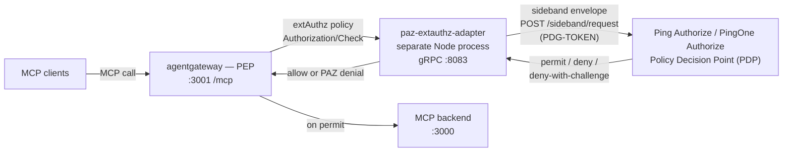

# agentgateway — Ping Authorize Sideband Integration

This folder contains the [agentgateway](https://agentgateway.dev/) (standalone
binary) integration that uses Ping Authorize (self-hosted) or PingOne
Authorize (cloud) as the centralized Policy Decision Point (PDP) for MCP
(Model Context Protocol) traffic, using the **Sideband API**.

The gateway acts as the Policy Enforcement Point (PEP): it intercepts every
MCP call, its extAuthz policy forwards the call context to a small adapter,
the adapter POSTs the original request to the authorization server's sideband
endpoint, and the decision — permit, deny with a machine-readable reason, or
deny-with-challenge for human-in-the-loop flows — is enforced, fail-closed.

## Architecture



The adapter is **not** part of the agentgateway binary: it runs as its own
process (`npm start`), and agentgateway's extAuthz policy simply points at it
over gRPC on `:8083` (`LISTEN_PORT`). Locally the two run side by side, but
the adapter can be deployed anywhere reachable — it speaks the vendored Envoy
ext_authz contract, so any Envoy-compatible PEP can use it.

Fail-closed throughout: a sideband transport failure or non-200 PDP response
becomes a 502 (`sideband-unavailable` / `sideband-error`), and
`failureMode: deny` covers an adapter outage.

---

## Folder layout

```
agentgateway/
├── README.md                          # this file
├── package.json                       # @grpc/grpc-js + @grpc/proto-loader; npm test / npm start
├── src/
│   ├── paz-extauthz-adapter.mjs       # the gRPC adapter (Envoy ext_authz ⇄ sideband)
│   ├── agentgateway.yaml              # agentgateway standalone config
│   └── proto/
│       ├── ext_authz.proto            # vendored from agentgateway 1.5.0 (do not modify)
│       └── shared_envoy.proto
└── test/
    ├── policy-e2e-tests.sh            # 19-test end-to-end policy matrix
    ├── test.md                        # testing: sample MCP, policies, local setup, tests
    ├── *.test.mjs                     # adapter unit + loopback tests (npm test)
    └── policy-snapshot/
        ├── Portfolio MCP policies.snapshot   # importable Policy Editor snapshot
        └── build-portfolio-snapshot.mjs      # regenerates the snapshot from the mortgage template
```

## Why an adapter exists at all

PAZ signals **deny with HTTP 200 + an embedded `response` object**;
agentgateway's extAuthz treats every 2xx from the authorization service as
**allow**. Pointing extAuthz straight at PAZ would pass every denial
silently. The adapter flips that encoding and builds the sideband envelope —
the same job the APIM policy fragment does inline, as a standalone service.

It speaks the **Envoy External Authorization gRPC protocol**
(`envoy.service.auth.v3.Authorization/Check` — the exact proto agentgateway
consumes, vendored from the installed binary's revision), which makes it
reusable with any Envoy-compatible PEP (agentgateway k8s mode, Istio) later.

## How the adapter works

1. **Extract the call context** from the `CheckRequest`: method, path,
   headers (Envoy's map — duplicates merged per the HTTP spec), body, and the
   real client source IP/port (a fidelity gain over the APIM fragment, which
   had to fake the source port).
2. **Build the sideband envelope** exactly as the APIM fragment does:
   headers as an array of single-key objects, body as a string, bare
   `http_version`, `source_port` as text.
3. **POST to `{SERVICE_URL}/sideband/request`** with the shared secret in the
   `PDG-TOKEN` header; on transport failure retry twice (one immediate, one
   after 1s — the decision probe is idempotent).
4. **Translate the decision**:

| PAZ says | Adapter CheckResponse | Client sees |
|---|---|---|
| 200, no `response` object | gRPC OK | normal MCP response |
| 200, `response` = deny | `DeniedHttpResponse` with PAZ's status/headers/body | PAZ denial (401/403, `WWW-Authenticate` challenge, JSON-RPC error `-32001`/`-32003`) |
| sideband unreachable ×3 | `DeniedHttpResponse` 502 `sideband-unavailable` | fail-closed |
| PAZ non-200 | `DeniedHttpResponse` 502 `sideband-error` | fail-closed |
| adapter down | gRPC error → agentgateway `failureMode: deny` | fail-closed |

On a deny without a body, the adapter synthesizes a JSON-RPC error envelope
(`-32001` for 401, `-32003` for 403) echoing the original JSON-RPC `id`, so
MCP clients can correlate the denial with their pending request. No
permit-on-error path exists anywhere in the chain.

## Configuration

The adapter reads environment variables (`.env` is loaded by `npm start`;
see [`.env.example`](.env.example)):

| Variable | Meaning | Default |
|---|---|---|
| `SERVICE_URL` | PAZ sideband base URL, **without** `/sideband/request` | — (required) |
| `SECRET_HEADER_VALUE` | sideband shared secret (sent as `PDG-TOKEN`) | — (required) |
| `SIDEBAND_TIMEOUT_MS` | per-attempt sideband call timeout | `5000` |
| `DEBUG_LOGGING` | redacted request/response diagnostics | `false` |
| `LISTEN_PORT` | adapter gRPC listen port | `8082` |

The gateway side is [`src/agentgateway.yaml`](src/agentgateway.yaml)
(simplified MCP mode — the top-level `mcp:` block, which is also the form
the management UI's MCP page reads and writes — validated with
`agentgateway --validate-only`):

- **`/mcp`** (and `/sse`) — the aggregated MCP endpoint: proxies
  `http://localhost:3000/mcp/portfolio` with `extAuthz` attached under
  `mcp.policies` (gRPC to `localhost:8083` — `LISTEN_PORT` in `.env`, the
  code default is 8082; `failureMode: deny`, request body forwarded up
  to 64 KiB, 5s callout budget).
- **`/.well-known/oauth-protected-resource`** — plain HTTP passthrough to
  demo-mcp, which serves the RFC 9728 protected-resource metadata document;
  the route rewrites the client-facing suffix to the backend's expected
  path and injects `X-Client-Host`/`X-Client-Proto` so the backend builds
  the client-facing `resource` identifier (RFC 8707). The same reason APIM
  needed a second, plain API for metadata.

Deliberate omissions, mirroring the APIM integration: **no
`mcpAuthentication`** (PAZ validates the bearer token from the envelope via
the sideband endpoint's token validator), no `backendAuth` (the demo backend
is open — see the disclaimer in `test/test.md`), no decision caching
(decisions depend on token + body; a cache key would be the whole request).

## Running locally

```bash
cd ~/Documents/projects/ai/demo-mcp && npm run dev        # 1. the MCP backend  :3000
cd agentgateway && cp .env.example .env && npm start      # 2. the adapter       :8083 (LISTEN_PORT)
/usr/local/bin/agentgateway -f src/agentgateway.yaml      # 3. the gateway       :3001
```

Then point an MCP client at `http://localhost:3001/mcp` (management UI at
`http://localhost:15000/ui`).

## Pointing at the policies

The adapter never references policies directly — it POSTs the request context
to the PAZ sideband endpoint, and the **endpoint's `service` property**
selects which policy set evaluates. The portfolio policy snapshot, the PAZ
sideband configuration, and the full test walkthrough are in
[`test/test.md`](test/test.md).

**➡️ Continue with [`test/test.md`](test/test.md)** — the sample mortgage-era
policies ported to the portfolio MCP (`amount`-tiered HITL with a six-field
transaction mirror), the PAZ setup, the local wiring, and the 19-test matrix.

## Kubernetes deployment (self-contained stack)

`k8s/helm/agentgateway-stack/` deploys the whole chain into a single
namespace: PAZ + PAP (Ping chart, StatefulSets, PAZ standalone with its
embedded store),
paz-extauthz-adapter, agentgateway (standalone mode, config from ConfigMap),
and demo-mcp. Policies, the jwt-lab token validator, and the sideband
endpoint bootstrap automatically from the server profiles in
`k8s/server-profiles/` (PAZ dsconfig layer + full-branch policy snapshot).
The snapshot is imported at first start, but **import alone is not live**:
the bootstrap imports it into its own branch and it must be merged into
SYSTEM and committed — a manual admin-API step, exactly sequenced in
[`k8s/server-profiles/pingauthorizepap/policies/README.md`](k8s/server-profiles/pingauthorizepap/policies/README.md).

Public surface: the AG MCP endpoint and the PAP UI (both via Ingress; TLS
issued by cert-manager). Everything else is cluster-internal.

### What the chart needs from your cluster

The chart is self-contained (PAZ, PAP, adapter, gateway, demo backend all
deploy from it), but the cluster must provide:

| Prerequisite | Detail |
|---|---|
| Helm 3 + `kubectl` | recent versions |
| An nginx ingress controller | the chart pins ingress class `nginx-public` — edit `templates/ingress-agentgateway.yaml` / `ingress-pap.yaml` if yours differs |
| cert-manager installed | public TLS issues via the `Certificate` resources in `templates/certificates.yaml`; the issuer is pinned to ClusterIssuer `letsencrypt-pdo` — edit that file to your issuer, or point the ingresses' `secretName` at your environment's existing cert |
| DNS for the two public hosts | `agentgateway.publicHost` and `pap.publicHost` (defaults under `*.ping-devops.com`) must resolve to your ingress controller before TLS can issue |
| Cluster egress to GitHub | the Ping products clone their server profiles at boot from `SERVER_PROFILE_URL` (defaults to this public repo — no fork needed unless you customize policies) |
| Registry access | `carbonefederico/*` (Docker Hub), `ghcr.io/agentgateway/agentgateway`, `pingidentity/*` (Ping images; the EULA env is already set in values) |

### Configure before install

All in `k8s/helm/agentgateway-stack/values.yaml`:

1. **Public hosts** — `agentgateway.publicHost` and `pap.publicHost`.
2. **PAP administrator password** — with Ping chart defaults it is the
   well-known DevOps default (`2FederateM0re`). Change it via the
   subchart's `masterPassword` block (see the Ping DevOps docs at
   https://devops.pingidentity.com for `masterPassword`/Vault options), or
   don't expose PAP publicly at all — see Security posture.
3. Optional: custom policies — fork the repo and repoint
   `ping-devops.pingauthorize.envs.SERVER_PROFILE_URL/PATH` (and the pap
   pair) at your fork.

### Deploy

    cd k8s/helm/agentgateway-stack
    helm dependency update
    helm install agentgateway-stack . -n <your-namespace>

Once DNS resolves, cert-manager issues the certificates automatically.

### Post-install: make the policies live (manual, ~5 API calls)

The bootstrap imports the policy snapshot into its own version-control
branch; it must be merged into SYSTEM and committed before the PDP serves
it — until then every call is denied. Exact sequence (works over
`kubectl port-forward svc/<release>-pingauthorizepap 8443` too):
[`k8s/server-profiles/pingauthorizepap/policies/README.md`](k8s/server-profiles/pingauthorizepap/policies/README.md).

### Verify

    helm test agentgateway-stack -n <your-namespace>
    cd test && AG_URL=https://<ag-host>/mcp \
      AUD=https://<ag-host> ./policy-e2e-tests.sh   # 19/19

The helm test asserts tokenless → 401/403, garbage token → 401
`invalid_token` (a positive policy verdict — it only passes once the
post-install commit step is done), demo-mcp health, and adapter reachability.

### Security posture

- **PAP admin console is exposed publicly by default, with the well-known
  DevOps default password.** It can rewrite the policy tree gating the
  gateway — do not leave this as-is on an internet-facing cluster: remove
  the PAP ingress (admin work runs over `kubectl port-forward`) or set a
  real administrator password first.
- AG management UI is not exposed; use
  `kubectl port-forward -n <ns> deploy/<release>-agentgateway 15000:15000`
  (loopback only — never publish the admin interface).
- The PAZ⇄adapter sideband secret is generated once at install and reused
  across upgrades; it never leaves the namespace.
